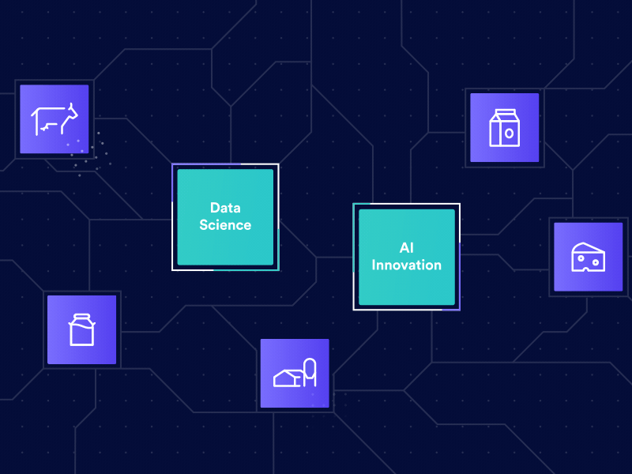

# 🎓 Welcome to the Capstone Course!

## 👋 Hello Students!

Welcome to an exciting journey of innovation and discovery! This capstone course represents the culmination of your academic experience, where you'll apply everything you've learned to solve real-world problems and create meaningful solutions.

## 📋 Important Setup Instructions

### 🤝 Adding Me as a Collaborator

**CRITICAL FIRST STEP:** You must add me as a collaborator to your GitHub repository so I can monitor your progress and provide guidance.

**My GitHub Username:** `amir-capstone-jafari`

#### How to Add Me as a Collaborator:
1. Navigate to your project repository on GitHub
2. Click on **Settings** (top menu bar of your repo)
3. Click on **Collaborators** in the left sidebar
4. Click **Add people**
5. Enter my username: `amir-capstone-jafari`
6. Select **Write** or **Admin** access level
7. Click **Add amir-capstone-jafari to this repository**

⚠️ **Note:** I will not be able to access your project or provide feedback until you complete this step!

## 📁 Project Naming Convention

Your repository name **MUST** follow this specific pattern:

### Format: `[semester]-[year]-[group#]`

**Examples:**
- `fall-2025-group1`
- `fall-2025-group2`
- `spring-2026-group1`
- `summer-2025-group3`

### Naming Rules:
- Use **lowercase letters only**
- Use **hyphens** to separate words (no spaces or underscores)
- Include the **full year** (e.g., 2025, not 25)
- Use **group** followed by your group number

## 🏗️ Project Structure Template

Your project should follow the folder structure outlined in the sample capstone project. 

### 📂 Repository Usage Instructions:

**IMPORTANT:** Please note the distinction between two repositories:

1. **For Collaboration:** Add `amir-capstone-jafari` as a collaborator to YOUR project repository
2. **For Template:** Use the `amir-jafari` repository structure as your template

**📂 Template Repository:** [amir-jafari Capstone Structure](https://github.com/amir-jafari/Capstone/tree/main/Capstone-Course/Sample_Capstone)

### 📋 Required Folder Structure:

Your project **MUST** follow this exact folder structure:

```
.
├── src
│   ├── component          # All classes and functions need to be here
│   ├── docs              # Documentation files
│   ├── shellscripts      # Shell scripts for automation
│   └── tests             # Unit tests and test files
├── demo
│   └── fig               # Demo figures and images
├── reports
│   ├── Latex_report
│   │   └── fig           # Figures for LaTeX report
│   ├── Markdown_Report   # Markdown format reports
│   ├── Progress_Report   # Weekly progress reports
│   │   └── Markdown_CheatSheet
│   └── Word_Report       # Word format reports
├── presentation          # Presentation materials
├── research_paper
│   ├── Latex
│   │   └── Fig          # Figures for research paper
│   └── Word             # Word format research paper
└── cookbooks            # Jupyter notebooks and tutorials
```

### 📁 Folder Descriptions:

- **src/component:** All classes and functions need to be here
- **src/docs:** Documentation and API references  
- **src/tests:** Unit tests and testing frameworks
- **demo/fig:** Demonstration figures, screenshots, and visual materials
- **reports:** All project reports in various formats
- **presentation:** Presentation slides and materials
- **research_paper:** Academic paper in LaTeX and Word formats
- **cookbooks:** Jupyter notebooks, tutorials, and code examples


## 📊 Project Management Requirements

I will be monitoring your project management practices through GitHub. Please ensure:

### 🎯 Required GitHub Features:
- [ ] **Issues:** Use for tracking bugs, features, and tasks
- [ ] **Projects/Boards:** Organize your workflow (Kanban style recommended)
- [ ] **Milestones:** Set clear project milestones with deadlines
- [ ] **Pull Requests:** Use for code reviews and feature integration
- [ ] **Regular Commits:** Commit frequently with descriptive messages
- [ ] **Branches:** Use feature branches for development

### 📋 GitHub Project Board Setup

**REQUIRED:** You must set up a GitHub Project Board and add me as a collaborator so I can monitor your project progress.

#### Step-by-Step Project Board Setup:

1. **Create a Project Board:**
   - Navigate to your repository on GitHub
   - Click on the **Projects** tab (next to Issues, Pull requests, etc.)
   - Click **New project**
   - Choose **Board** template (Kanban style)
   - Name your project board (e.g., "Capstone Project Management")
   - Add a description of your project

2. **Add Me as Project Collaborator:**
   - In your project board, click on the **Settings** icon (gear icon)
   - Go to **Manage access** or **Collaborators**
   - Click **Add people**
   - Enter my username: `amir-capstone-jafari`
   - Give me **Admin** or **Write** access to the project board
   - Click **Add** to confirm

3. **Set Up Project Columns:**
   - Create these columns in your project board:
     - **📝 To Do** - Tasks to be started
     - **🔄 In Progress** - Currently working on
     - **👀 In Review** - Waiting for review/approval
     - **✅ Done** - Completed tasks

4. **Create Project Tickets/Issues:**
   - Break down your project into manageable tasks
   - Create GitHub Issues for each task
   - Add these issues to your project board
   - Assign issues to team members
   - Set due dates and priorities

#### 🎫 Ticket Management Best Practices:
- **Clear Titles:** Use descriptive titles for each ticket
- **Detailed Descriptions:** Include acceptance criteria and requirements
- **Labels:** Use labels to categorize tickets (bug, feature, documentation, etc.)
- **Assignees:** Assign each ticket to a team member
- **Due Dates:** Set realistic deadlines for each task
- **Progress Updates:** Move tickets between columns as work progresses

### 📈 Progress Tracking:
- Create weekly progress reports in your `reports/Progress_Report/` folder
- Update your project board regularly (at least twice per week)
- Tag me in important discussions using `@amir-capstone-jafari`
- Move tickets through the board columns as work progresses
- Add comments to tickets when significant progress is made

⚠️ **Important:** I must be able to see your project board to monitor your team's progress and provide feedback!

## 🚀 Getting Started Checklist

Before diving into your project, make sure you've completed:

- [ ] Created your repository with the correct naming convention
- [ ] Added `amir-capstone-jafari` as a collaborator
- [ ] Set up the recommended folder structure
- [ ] Created initial project documentation
- [ ] Set up GitHub project board
- [ ] Created your first milestone
- [ ] Added a comprehensive README for your specific project

## 📞 Communication & Support

### Getting Help:
- **GitHub Issues:** Tag me in issues that need instructor input
- **Discussion:** Use GitHub Discussions for broader questions
- **Office Hours:** Check course syllabus for scheduled times

### Response Time:
- I aim to respond to GitHub notifications within 24-48 hours
- For urgent matters, please email me directly

## 🎯 Success Tips

1. **Start Early:** Begin your project setup immediately
2. **Commit Often:** Small, frequent commits are better than large, infrequent ones
3. **Document Everything:** Good documentation is crucial for project success
4. **Collaborate Effectively:** Use GitHub's collaborative features
5. **Ask Questions:** Don't hesitate to reach out when you need help

## 📺 GitHub Page Requirements

### 🎬 Project Showcase Video

**REQUIRED:** Every group must create a one-minute video summarizing your entire project.

#### Video Requirements:
- **Duration:** Exactly 1 minute maximum
- **Content:** Showcase the main points of your project
- **Purpose:** Provide a quick overview for visitors to your GitHub page
- **Format:** Should be engaging and demonstrate your project's key features

#### Where to Include:
- Add the video to your main README.md file on your repository's GitHub page
- Place the video file in your `demo/fig/` folder
- Use the following markdown format in your README:



⚠️ **Note:** This video serves as the first impression of your project for anyone visiting your GitHub repository!

## 📚 Resources

- [GitHub Collaboration Guide](https://docs.github.com/en/github/collaborating-with-issues-and-pull-requests)
- [amir-jafari Template Repository](https://github.com/amir-jafari/Capstone/tree/main/Capstone-Course/Sample_Capstone)
- [Markdown Guide](https://www.markdownguide.org/)

---

