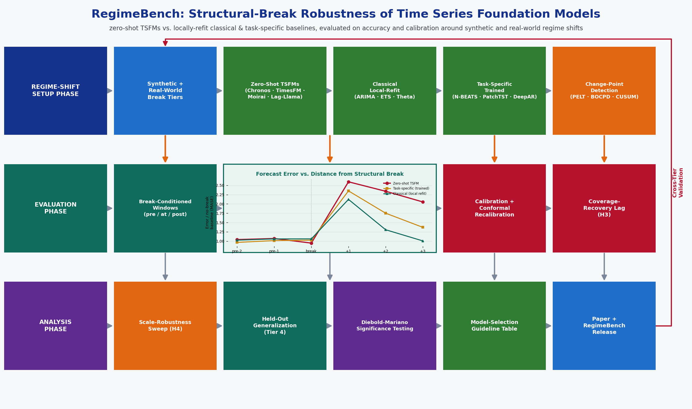

# Capstone Proposal
## RegimeBench: Are Zero-Shot Time Series Foundation Models Robust to Structural Breaks? A Forecasting-Accuracy and Calibration Benchmark Under Regime Shift
### Proposed by: Dr. Amir Jafari
#### Email: ajafari@gwu.edu
#### Advisor: Amir Jafari
#### The George Washington University, Washington DC  
#### Data Science Program

## 1 Objective:  

            Zero-shot time series foundation models (TSFMs) -- Chronos, TimesFM, Moirai, Lag-Llama -- are
            pretrained once on large cross-domain corpora and then forecast any new series without
            re-estimation, and they now match or beat classical statistical and task-specific deep-learning
            forecasters on standard benchmarks (Monash archive, M4/M5). Almost all of that evidence comes
            from series whose statistical properties are roughly stable across the evaluation window. Real
            deployment settings -- economic indicators around COVID-19, equity volatility around financial
            crises, energy demand around supply shocks -- are dominated by structural breaks: abrupt shifts
            in mean, variance, or trend. Classical statistical models (ARIMA, ETS) are refit on a rolling
            window and can adapt to a new regime within a few observations; a zero-shot foundation model has
            no such local re-estimation step and must generalize purely from pretraining. The goal of this
            project is to build a rigorous, reproducible benchmark that directly tests whether zero-shot
            TSFMs are actually robust to structural breaks, or whether their strong average-case benchmark
            numbers hide a blind spot that only shows up right when accurate forecasts matter most, using
            open-weight models small enough to run entirely on a single AWS g5.2xlarge instance (1x NVIDIA
            A10G, 24 GB VRAM, 8 vCPUs, 32 GiB RAM).

            Key Objectives:
            1. Implement a controlled synthetic regime-shift generator (mean shift, variance shift, trend
               shift, and frequency shift, injected at known times and magnitudes into ARIMA/GARCH-simulated
               base series) that provides exact ground-truth break locations, complementing real-world data
               where break timing must be estimated.
            2. Build a change-point-detection pipeline (PELT, Bayesian Online Changepoint Detection, CUSUM)
               to locate regime shifts in real-world series, validated against independently documented
               historical events (the COVID-19 onset, the 2008 and 2020 financial shocks, the 2021 Texas
               winter-storm energy shock) rather than trusted blindly.
            3. Benchmark four zero-shot open-weight TSFMs (Chronos, TimesFM, Moirai, Lag-Llama) against
               locally-refit classical statistical baselines (ARIMA, ETS, Theta) and per-dataset-trained
               task-specific deep models (N-BEATS, PatchTST, DeepAR) on point-forecast accuracy as a
               function of distance from the nearest detected or injected structural break.
            4. Evaluate the calibration of each model class's probabilistic forecasts (CRPS, pinball loss,
               prediction-interval coverage) before and after a break, and apply post-hoc adaptive conformal
               inference (Gibbs & Candes, 2021) to measure how many post-break windows each model class needs
               before nominal coverage is recovered.
            5. Sweep model scale within each TSFM family (e.g., Chronos-tiny/small/base) to test whether
               larger zero-shot foundation models are also more robust to regime shift, or whether scale and
               shift-robustness are unrelated, and package the full pipeline -- synthetic generator,
               change-point detector, forecasting models, calibration wrapper, and the resulting benchmarking
               DataFrame -- as an open-source, config-driven repository (RegimeBench).
            

*Figure 1: Caption*

## 2 Dataset:  

            All datasets below are publicly available for research use with no restricted access. The
            project organizes them into four tiers: a controlled synthetic benchmark with exact ground-truth
            break locations, a general-purpose zero-shot sanity check, a real-world documented-structural-
            break benchmark, and a held-out generalization tier.

            TIER 1 -- SYNTHETIC REGIME-SHIFT BENCHMARK (GROUND-TRUTH BREAKS):
            1. Base series simulated from ARIMA and GARCH processes (statsmodels/arch), with four injected
               break types at controlled, known locations and magnitudes: mean shift, variance shift, trend
               shift, and frequency/seasonality shift -- generated in Week 1, not downloaded; every break
               timestamp and magnitude is logged for exact pre/post-break evaluation windows
            2. A no-break control set (same generators, no injected shift) to establish each model's
               baseline accuracy absent any regime change

            TIER 2 -- GENERAL-PURPOSE ZERO-SHOT SANITY CHECK (NO BREAK LABELING):
            3. Monash Time Series Forecasting Archive (Godahewa et al., 2021) -- a curated multi-domain
               collection (electricity, traffic, tourism, weather, retail, and more) used to confirm every
               TSFM reproduces its published zero-shot benchmark numbers before it is trusted for the
               regime-shift analysis: https://forecastingdata.org/ / https://huggingface.co/datasets/monash_tsf
            4. M4 Competition dataset (Makridakis et al., 2020) -- 100k series across six frequencies,
               a second independent zero-shot sanity check: https://github.com/Mcompetitions/M4-methods

            TIER 3 -- REAL-WORLD DOCUMENTED STRUCTURAL BREAKS (MAIN EVALUATION):
            5. U.S. retail sales and economic indicators around the COVID-19 onset (March-April 2020) from
               FRED (Federal Reserve Economic Data): https://fred.stlouisfed.org/
            6. CDC FluView ILINet influenza-like-illness surveillance data, which shows a sharp, well-
               documented regime shift at the COVID-19 non-pharmaceutical-intervention onset:
               https://gis.cdc.gov/grasp/fluview/fluportaldashboard.html
            7. Daily realized volatility / closing-price series for major equity indices (S&P 500, VIX)
               spanning the 2008 global financial crisis and the March 2020 crash, both independently dated
               in the financial-econometrics literature, via Yahoo Finance historical data
            8. U.S. regional electricity demand around the February 2021 Texas winter-storm supply shock,
               via the EIA (U.S. Energy Information Administration) hourly demand data:
               https://www.eia.gov/opendata/
            For every Tier 3 series, the change-point-detection pipeline (Week 2) proposes candidate break
            timestamps, which are then cross-checked against the independently documented historical event
            dates above rather than accepted automatically.

            TIER 4 -- HELD-OUT GENERALIZATION (evaluation only, not tuned on):
            9. M5 Competition dataset (Makridakis et al., 2022) -- Walmart retail sales, including the
               COVID-19 period, used only in Week 12 as a final generalization check on data and a break
               event not used to develop the pipeline in Weeks 1-11:
               https://www.kaggle.com/competitions/m5-forecasting-accuracy

            DATASET / PIPELINE PREPARATION:
            - Standardize every tier behind a common loader that emits (context window, forecast horizon,
              known-or-detected break timestamp) tuples, so every model and every metric consumes an
              identical evaluation protocol regardless of tier
            - Fix a stratified evaluation sample per (tier, break type) with a documented random seed, and a
              fixed set of pre-break / at-break / post-break window offsets used consistently across every
              experiment in Phases 4-6
            - No live web APIs are required at run time -- Tier 3/4 sources are downloaded once in Week 2 and
              cached locally, keeping the pipeline reproducible and free of flaky external dependencies
            

## 3 Rationale:  

            Zero-shot time series foundation models are one of the most active current threads in
            forecasting research: Chronos (Ansari et al., 2024) tokenizes real-valued series and reuses a
            T5-style language-model architecture; TimesFM (Das et al., 2024) is a decoder-only foundation
            model pretrained on ~100B real-world time points; Moirai (Woo et al., 2024) is a masked-encoder
            model trained for universal, any-frequency forecasting; Lag-Llama (Rasul et al., 2024) is a
            probabilistic decoder-only foundation model. All four report strong zero-shot accuracy on the
            Monash archive and M4/M5-style benchmarks, in some cases matching or beating classical
            statistical models and task-specific deep learners that were trained or refit directly on the
            target series.

            But those benchmarks average performance across an entire evaluation window, and most of the
            series in them do not contain a sharp structural break. Classical statistical models (ARIMA,
            ETS) are refit on a rolling window and can absorb a regime shift within a handful of new
            observations; task-specific deep models are trained per dataset and see the full history at
            training time; a zero-shot foundation model, by construction, has no per-series re-estimation
            step at all -- it must forecast a post-break regime purely by pattern-matching against whatever
            it saw in pretraining. Whether this makes TSFMs systematically fragile exactly when a structural
            break occurs -- a recession onset, a pandemic, a supply shock, precisely the moments where an
            accurate forecast is most valuable -- is a question the standard average-case benchmarks cannot
            answer, because they do not condition error on distance from a break.

            No existing published study directly benchmarks multiple open-weight zero-shot TSFM families
            against locally-refit classical and task-specific baselines, conditioned explicitly on distance
            from a structural break, on both a controlled synthetic benchmark with known break ground truth
            and real-world series with independently documented historical break events, while also
            evaluating probabilistic calibration (not just point accuracy) before and after the break. This
            project fills that gap.

            WHY THIS PROJECT IS TIMELY AND PUBLISHABLE:
            - Time series foundation models are the fastest-moving current thread in forecasting research,
              with dedicated venues: the NeurIPS/ICML/ICLR workshops on time series and foundation models,
              and increasing coverage at KDD, TMLR, and in the International Journal of Forecasting.
            - The regime-shift-conditioned evaluation protocol (error and calibration as a function of
              distance from a break, not an unconditional average) is a clean, citable methodological
              contribution distinct from yet another leaderboard, and is directly reusable by future TSFM
              studies regardless of which new foundation model is released next.
            - The calibration and adaptive-conformal-recovery analysis (H2/H3 below) connects directly to the
              distribution-shift and conformal-prediction literature (Gibbs & Candes, 2021), giving the
              project a rigorous uncertainty-quantification angle beyond point-forecast accuracy.
            - A negative or null result (TSFMs are just as robust to breaks as locally-refit baselines) is
              just as publishable and useful to practitioners as a positive one -- the project is designed so
              every outcome is a reportable finding, not a failure condition.
            - The entire pipeline -- four TSFMs at their smallest/base checkpoints, classical statistical
              refitting, and lightweight task-specific training -- runs comfortably on one AWS g5.2xlarge,
              specifically so the project stays tractable for a student team without a multi-GPU cluster.
            

## 4 Approach:  

            PHASE 1: FOUNDATIONS & DATA PIPELINE (Weeks 1-2)

            [Week 1: Setup & Synthetic Regime-Shift Generator]
            - Install statsforecast/neuralforecast, sktime/darts, gluonts, the TSFM libraries (chronos-
              forecasting, timesfm, uni2ts for Moirai, lag-llama), ruptures (change-point detection), and
              conformal-prediction tooling (MAPIE or a custom adaptive-conformal-inference implementation)
            - Build the Tier 1 synthetic regime-shift generator: ARIMA/GARCH-simulated base series (via
              statsmodels/arch) with four injectable break types (mean, variance, trend, frequency shift) at
              controlled, logged locations and magnitudes; project structure: data/, models/, changepoint/,
              calibration/, benchmarks/, notebooks/
            - Create a model_registry.csv (model family, checkpoint size, context/horizon limits) and a
              run_matrix.csv enumerating every planned (model x tier x break-type x window-position)
              experiment up front, to keep the total run count bounded

            [Week 2: Real-World Data & Change-Point Detection Pipeline]
            - Download and cache Tier 2 (Monash archive, M4) and Tier 3 (FRED retail/economic series, CDC
              ILINet, S&P 500/VIX, EIA electricity demand) data
            - Implement the change-point-detection pipeline (PELT via ruptures, Bayesian Online Changepoint
              Detection, CUSUM) on Tier 3 series; cross-check detected break timestamps against independently
              documented historical event dates (COVID-19 onset, 2008/2020 financial shocks, Feb. 2021 Texas
              winter storm) before trusting the pipeline for later phases

            PHASE 2: FOUNDATION MODEL ZERO-SHOT BASELINES (Weeks 3-4)

            [Week 3: Deploy & Sanity-Check TSFMs]
            - Deploy the four zero-shot TSFMs at comparable small/base checkpoints (Chronos-t5-base,
              TimesFM-1.0-200M, Moirai-1.0-R-base, Lag-Llama) on the g5.2xlarge
            - Reproduce each model's published zero-shot accuracy on a Tier 2 (Monash/M4) subset before
              trusting the deployment for the regime-shift analysis

            [Week 4: Zero-Shot Forecasts on the Synthetic Benchmark]
            - Run all four TSFMs, fully zero-shot (no fine-tuning, no re-estimation), across Tier 1
              (synthetic, all four break types plus the no-break control), under a fixed context-
              window/horizon protocol identical across models

            PHASE 3: CLASSICAL & TASK-SPECIFIC BASELINES (Weeks 5-6)

            [Week 5: Classical Statistical Baselines]
            - Implement ARIMA, ETS, and Theta baselines (statsforecast) with rolling-window local
              re-estimation -- refit at every forecast origin, exactly as they are used in practice, unlike
              the zero-shot TSFMs

            [Week 6: Task-Specific Deep Learning Baselines]
            - Train N-BEATS, PatchTST, and DeepAR (neuralforecast/gluonts) per dataset on Tier 1 and a Tier 2
              subset; confirm the full three-model-class baseline suite (zero-shot TSFM, locally-refit
              classical, per-dataset-trained task-specific) is evaluated under one identical protocol

            PHASE 4: REGIME-SHIFT ROBUSTNESS EVALUATION (Weeks 7-8)

            [Week 7: Synthetic Break Robustness]
            - Run all three model classes across the full Tier 1 synthetic regime-shift benchmark; compute
              point-forecast error (MASE, sMAPE) as a function of signed distance from the known break --
              pre-break, at-break, and post-break windows at fixed offsets -- directly resolving H1 on
              ground-truth breaks

            [Week 8: Real-World Break Robustness]
            - Extend the same protocol to Tier 3 real-world series, using the Week 2 change-point-detection
              pipeline's validated break timestamps in place of ground truth; compare the real-world
              degradation pattern against the synthetic-benchmark pattern from Week 7

            PHASE 5: PROBABILISTIC CALIBRATION ANALYSIS (Weeks 9-10)

            [Week 9: Pre/Post-Break Calibration]
            - Compute probabilistic calibration metrics (CRPS, pinball loss, prediction-interval coverage
              probability, interval width) for every model's forecasts across Tiers 1 and 3, split by
              pre-break vs. post-break window, directly resolving H2

            [Week 10: Adaptive Conformal Recalibration]
            - Implement adaptive conformal inference (Gibbs & Candes, 2021) as a post-hoc recalibration
              wrapper applicable to any model's point/quantile forecasts; measure, per model class, how many
              post-break forecast origins are needed before nominal interval coverage is recovered --
              directly resolving H3

            PHASE 6: SCALE SWEEP & CROSS-CONDITION ANALYSIS (Weeks 11-12)

            [Week 11: Within-Family Scale Sweep]
            - Re-run the Tier 1 synthetic benchmark with the smallest and largest available checkpoint per
              TSFM family (e.g., Chronos-tiny vs. Chronos-base, Moirai-small vs. Moirai-base) to test whether
              larger zero-shot models are more or less robust to regime shift -- directly resolving H4

            [Week 12: Master Benchmark Assembly & Held-Out Check]
            - Assemble the full benchmarking DataFrame: (model x tier x break-type x window-position) ->
              MASE/sMAPE, CRPS, PICP, coverage-recovery-lag
            - Evaluate the best-performing configuration per model class on the held-out Tier 4 (M5) series
              to test whether the Weeks 7-11 findings generalize to a dataset and break event not used to
              develop the pipeline
            - Formally state the project's four central hypotheses being tested against this DataFrame:
              H1: Does zero-shot TSFM point-forecast accuracy degrade more sharply than locally-refit
                  classical and per-dataset-trained task-specific baselines in the windows immediately
                  following a structural break?
              H2: Are TSFM probabilistic forecasts systematically mis-calibrated (over- or under-confident),
                  and does calibration quality itself degrade disproportionately around a break, relative to
                  the other two model classes?
              H3: After adaptive conformal recalibration, do TSFMs need more post-break forecast origins than
                  classical/task-specific baselines to recover nominal interval coverage?
              H4: Within a TSFM family, is larger zero-shot model scale associated with greater robustness to
                  regime shift, or are scale and shift-robustness unrelated?

            PHASE 7: STATISTICAL TESTING & CHANGE-POINT VALIDATION (Weeks 13-14)

            [Week 13: Statistical Testing]
            - Diebold-Mariano tests on pre-vs-post-break paired forecast-error deltas, per model and model
              class; regression of error degradation on model class, break type, and break magnitude,
              directly resolving H1 and H4 with significance levels attached

            [Week 14: Change-Point-Detection Pipeline Validation]
            - Both students independently audit a stratified sample of Tier 3 detected break timestamps
              against the independently documented historical record; compute detection precision/recall
              against the known event dates and report it explicitly, rather than assuming the automatic
              detector is correct throughout the benchmark

            PHASE 8: GUIDELINES, PAPER, AND CODE RELEASE (Weeks 15-16)

            [Week 15: Research Paper Draft]
            Paper structure (8-10 pages, NeurIPS/ICML/ICLR time-series-workshop or TMLR/International
            Journal of Forecasting format):
            1. Abstract: motivation, RegimeBench scope, key findings (H1-H4)
            2. Introduction: the regime-shift blind spot in zero-shot TSFM benchmarking
            3. Related Work: Chronos, TimesFM, Moirai, Lag-Llama, classical/task-specific forecasting,
               change-point detection, conformal prediction under distribution shift
            4. RegimeBench: synthetic generator, change-point pipeline, models, evaluation protocol
            5. Results: break-conditioned accuracy degradation, calibration, conformal-recovery lag
            6. The Scale-Robustness Relationship Within TSFM Families
            7. Practical Guidelines for Forecasting Across a Suspected Regime Shift
            8. Conclusion & Future Work: online/continual adaptation of TSFMs, multivariate regime shifts

            [Week 16: Code Release & Documentation]
            - Publish the RegimeBench GitHub repository: config-driven
              run_benchmark.py --model all --tier all --break-type all
            - Jupyter notebooks: one per phase and one cross-condition analysis notebook
            - README with quickstart, single-GPU reproduction guide, and the synthetic-generator API
            - requirements.txt with pinned dependencies; final presentation
            

## 5 Timeline:  

            Week 1:    Synthetic regime-shift generator (Tier 1), model_registry.csv, run_matrix.csv
            Week 2:    Tier 2/3 data cached; change-point-detection pipeline validated vs. historical events
            Week 3:    Four TSFMs deployed; zero-shot accuracy reproduced on Tier 2 (Monash/M4) sanity check
            Week 4:    Zero-shot TSFM forecasts run across full Tier 1 synthetic regime-shift benchmark
            Week 5:    Classical baselines (ARIMA/ETS/Theta) implemented with rolling-window local refitting
            Week 6:    Task-specific baselines (N-BEATS/PatchTST/DeepAR) trained per dataset
            Week 7:    Break-conditioned accuracy evaluation on Tier 1 (ground-truth breaks) -- H1 groundwork
            Week 8:    Break-conditioned accuracy evaluation extended to Tier 3 real-world documented breaks
            Week 9:    Pre/post-break probabilistic calibration metrics (CRPS, pinball loss, PICP) -- H2
            Week 10:   Adaptive conformal recalibration; post-break coverage-recovery-lag measured -- H3
            Week 11:   Within-TSFM-family scale sweep (tiny/small vs. base checkpoints) -- H4
            Week 12:   Master benchmarking DataFrame assembled; Tier 4 (M5) held-out generalization check
            Week 13:   Diebold-Mariano significance testing; error-degradation regression resolving H1/H4
            Week 14:   Change-point-detection pipeline precision/recall validated against historical record
            Week 15:   Research paper draft (NeurIPS/ICML/ICLR workshop or TMLR/IJF format)
            Week 16:   RegimeBench code release, README, notebooks, final presentation

            TOTAL: 16 weeks (one semester)

            KEY MILESTONES:
            - Week 4:  Zero-shot TSFM baselines complete on the synthetic ground-truth regime-shift benchmark
            - Week 6:  Classical and task-specific baseline suite complete, matched to the TSFM protocol
            - Week 8:  Break-conditioned accuracy evaluation complete on both synthetic and real-world tiers
            - Week 10: Calibration and adaptive-conformal-recovery analysis complete
            - Week 12: All hypothesis tests (H1-H4) resolved in the master benchmarking DataFrame
            - Week 14: Change-point-detection pipeline formally validated against the historical record
            - Week 16: Paper submitted; code released to the RegimeBench GitHub repository

            DELIVERABLES BY WEEK 16:
            - A structural-break-conditioned forecasting benchmark spanning four zero-shot open-weight time
              series foundation models, locally-refit classical baselines, and per-dataset task-specific deep
              models, on synthetic (ground-truth) and real-world (documented) regime shifts
            - Quantitative answers to whether zero-shot TSFM accuracy and calibration degrade disproportion-
              ately around structural breaks, and whether model scale predicts shift-robustness
            - A validated change-point-detection pipeline with reported precision/recall against real events
            - A post-hoc adaptive-conformal-recalibration wrapper with measured post-break recovery lag
            - A practical model-selection guideline table for forecasting across a suspected regime shift
            - Research paper draft (8-10 pages)
            - Open-source RegimeBench repository with reproducible notebooks
            

## 6 Expected Number Students:  

            RECOMMENDED: 2-3 students

            ROLE DISTRIBUTION FOR 2 STUDENTS:

            Student 1: Foundation Model Serving, Zero-Shot Benchmarking & Calibration
            - Responsibilities: deploy and sanity-check the four TSFMs (Chronos, TimesFM, Moirai, Lag-Llama),
              zero-shot forecasting sweep across Tiers 1-4, probabilistic calibration metrics (CRPS, pinball
              loss, PICP), adaptive conformal recalibration wrapper and coverage-recovery-lag measurement,
              within-family scale sweep (H4)
            - Skills: deep learning / transformer inference, probabilistic forecasting, Python, uncertainty
              quantification

            Student 2: Classical & Task-Specific Baselines, Change-Point Detection & Statistical Testing
            - Responsibilities: ARIMA/ETS/Theta rolling-refit baselines, N-BEATS/PatchTST/DeepAR training,
              the change-point-detection pipeline (PELT/BOCPD/CUSUM) and its historical-event validation,
              master benchmarking DataFrame, Diebold-Mariano significance testing and hypothesis resolution
              (H1-H4)
            - Skills: classical time series econometrics, statistical testing, Python, change-point detection

            SHARED RESPONSIBILITIES (both students):
            - Cross-condition analysis, break-conditioned evaluation-window design, guideline synthesis,
              paper writing, code documentation, final presentation
            - Weekly integration meetings: every model class feeds the same fixed data pipeline and
              evaluation protocol from Phase 1

            FOR 3 STUDENTS (optional third role):
            Student 3: Benchmarking Infrastructure, Evaluation & Visualization
            - Responsibilities: build the config-driven multi-run experiment orchestrator and run_matrix.csv
              tracker, own the synthetic regime-shift generator and its ground-truth logging, design the
              Tier 3 historical-event cross-validation protocol, produce all publication-quality figures
              (break-conditioned error curves, calibration-vs-distance-from-break plots, coverage-recovery
              curves, scale-robustness scatter), maintain the RegimeBench repository structure
            

## 7 Possible Issues:  

            TECHNICAL CHALLENGES AND SOLUTIONS:

            1. Real-World Break Timestamps Are Estimated, Not Ground Truth:
            - ISSUE: PELT/BOCPD/CUSUM can mislocate or miss breaks in Tier 3 real-world series, unlike the
              exact synthetic ground truth in Tier 1
            - SOLUTION: Cross-check every Tier 3 detected break against an independently documented
              historical event date (Week 2), and formally validate detector precision/recall against that
              record in Week 14 rather than trusting detected timestamps throughout

            2. Comparing a Zero-Shot Model to a Locally-Refit Model Is an Apples-to-Oranges Design by
               Construction:
            - ISSUE: Classical/task-specific baselines are allowed to re-estimate on recent data while TSFMs
              are not, which could look like an unfair comparison
            - SOLUTION: This asymmetry is the entire research question, not a confound to remove -- each
              model class is evaluated exactly as it is used in practice (TSFMs zero-shot, classical models
              refit), and the paper states this explicitly as the studied factor rather than a nuisance
              variable

            3. TSFMs May Simply Be Robust to Regime Shift (Null Result):
            - ISSUE: The central hypothesis (H1) could fail to hold -- TSFMs might degrade no more than the
              baselines
            - SOLUTION: A null result is a valid, reportable, and publishable finding (it would say TSFMs are
              production-ready even under regime shift); the paper narrative and analysis pipeline are
              designed from Week 1 to accommodate either outcome

            4. Differing Context-Length / Frequency Requirements Across TSFM Families:
            - ISSUE: Chronos, TimesFM, Moirai, and Lag-Llama differ in maximum context length and supported
              frequencies, complicating a strictly identical protocol
            - SOLUTION: Fix a common context window / horizon within each model's supported range, document
              any per-model deviation in model_registry.csv, and verify Week 3 zero-shot sanity-check numbers
              before trusting the deployment

            5. Change-Point Detectors Have Their Own False-Positive/Negative Rate:
            - ISSUE: An unvalidated detector could mislabel evaluation windows, contaminating the Tier 3
              results
            - SOLUTION: Week 2 validates the pipeline against known events before the main sweep, and Week 14
              re-validates it with an independent manual audit, reporting precision/recall explicitly

            6. Total Run Count Across the Full Sweep:
            - ISSUE: 4 TSFM families x scale variants x 3 classical/task-specific baselines x 4 tiers x
              multiple break types/window positions could balloon the compute and analysis budget
            - SOLUTION: The full run matrix is enumerated in run_matrix.csv in Week 1 so the total is
              bounded and auditable before any runs begin; the scale sweep (H4) is restricted to Tier 1 only

            7. Library / Version Drift:
            - ISSUE: The TSFM libraries (chronos-forecasting, timesfm, uni2ts, lag-llama) are all actively
              maintained; API changes could break reproducibility mid-semester
            - SOLUTION: Pin all dependency versions in requirements.txt from Week 1

            RISK MITIGATION TIMELINE:
            - Weeks 1-3:  Verify TSFM zero-shot accuracy against published reference numbers (Monash/M4) and
                          validate the change-point pipeline against historical events before the main sweep
            - Weeks 4-11: Monitor per-model run completion and intermediate break-conditioned error curves as
                          each phase comes online; checkpoint intermediate results after every phase
            - Weeks 12-13: Cross-check held-out Tier 4 results against the Tier 1/3 findings for consistency
                          before finalizing H1-H4
            - Week 14:    Independent manual audit of change-point-detection precision/recall by both
                          students
            - Weeks 15-16: 3-day code freeze for README and notebook review before public release
            

## Contact
- Author: Amir Jafari
- Email: [ajafari@gwu.edu](mailto:ajafari@gwu.edu)
- GitHub: 
